<div align="center">

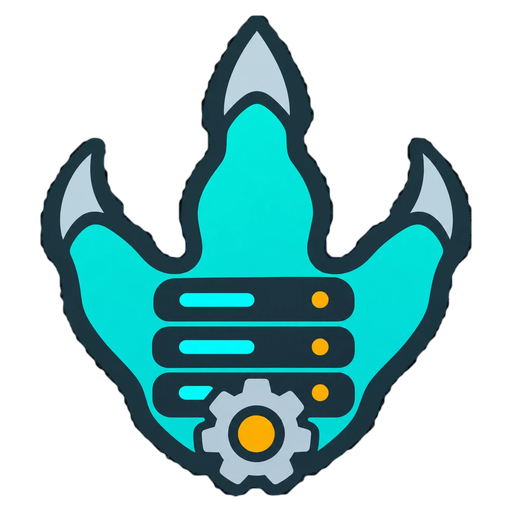

# ObeliskPanel

**A free server manager for ARK: Survival Ascended and ARK: Survival Evolved.**

Install, configure, back up, restart and watch your ARK servers from one window. No subscription, no "Pro" tier, no feature hidden behind a paywall.


**[⬇ Download ObeliskPanel 1.0.0 (Windows, 2 MB)](../../raw/main/release/ObeliskPanel-1.0.0-win-x64.zip)**

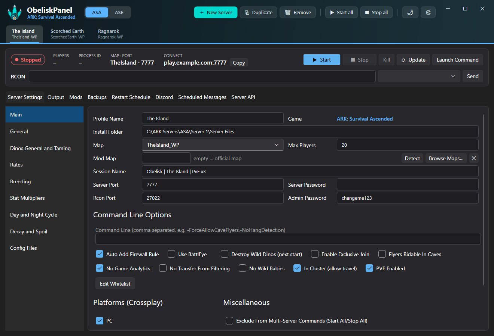

</div>

---

## Contents

- [What it does](#what-it-does)
- [Getting started](#getting-started)
- [Requirements](#requirements)
- [API keys](#api-keys)
- [Building from source](#building-from-source)
- [Why I built this](#why-i-built-this)

---

## What it does

### ASA and ASE, kept apart

You switch between **ASA** and **ASE** at the top. Each game has its own server list, its own cluster and its own settings, so an ASE-only option never ends up in an ASA config by accident. Servers get installed and updated through SteamCMD with an anonymous login, so you don't need a Steam account.

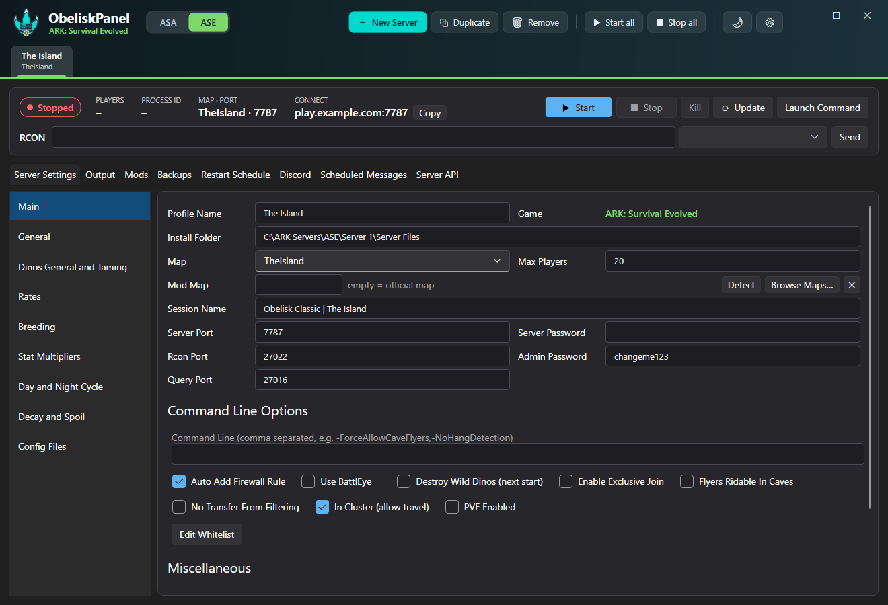

### Settings you can actually read

All the common GameUserSettings.ini and Game.ini values are grouped into pages: General, Dinos and Taming, Rates, Breeding, Stats, Day/Night, Decay. Every value shows its default next to it. If you changed something, a small red **✕** appears, and one click sets it back to the default. If you'd rather edit the raw files, you still can.

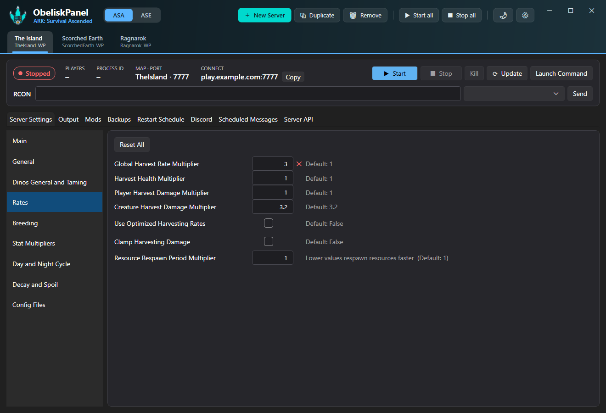

### Mods

- **ASA:** a CurseForge browser built into the app.
- **ASE:** a Steam Workshop browser.

You can also paste an ID or a Workshop link. Mod maps work for both games. Many mods have their own INI settings. ObeliskPanel looks inside the mod files to find which options a mod reads, so you can set them without digging through the mod page.

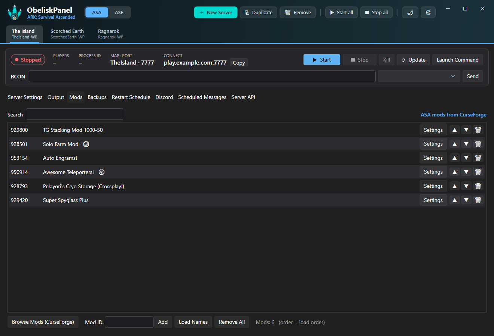

### Backups

- **Create:** one click, or automatically every X minutes.
- **Retention:** you choose how many backups to keep, and the oldest get removed.
- **Restore:** an **Undo Last Restore** button brings back what you had before.
- **Cluster:** you can include the cluster folder if you run several maps.

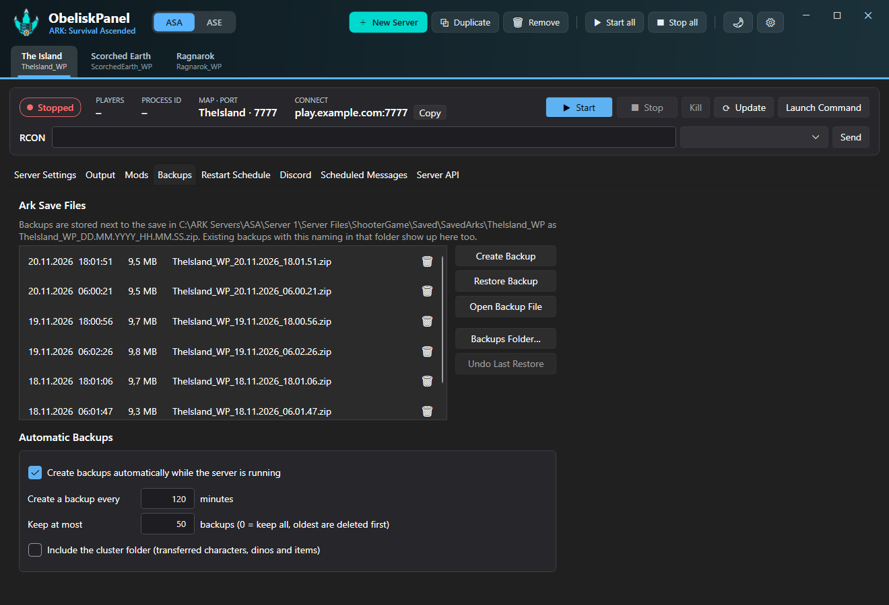

### Restarts, updates and wipes

Pick the days and times. Players get an in-game countdown. Then the server saves, shuts down cleanly, makes a backup, updates through SteamCMD and starts again. If nobody is online, it skips the countdown. You can also schedule wipes on certain days of the month, either the world only or players and tribes too. A backup is always made first.

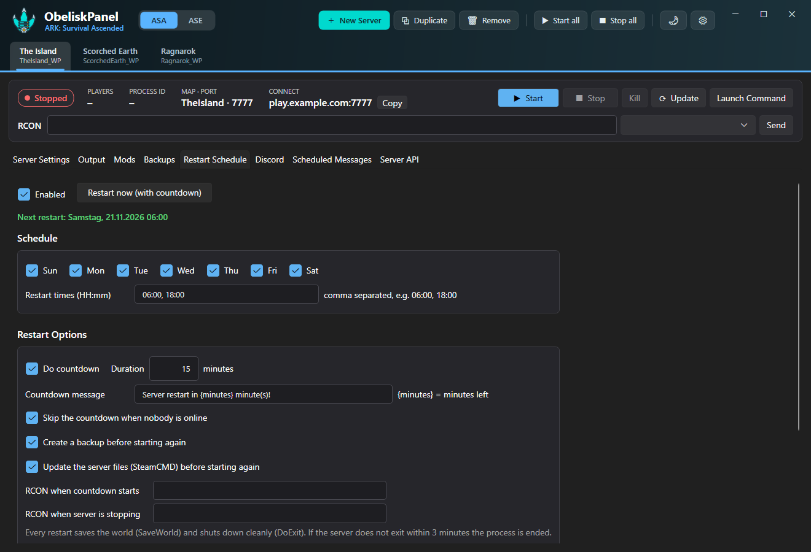

### Discord

**Webhooks** post to your channel when a server starts, comes online, stops or updates, when players join or leave, and they can relay global chat. Every message can include the connect address, because ObeliskPanel picks up your public IP by itself.

There is also an optional **Discord bot** with these commands:

| Command | What it does | Who can use it |
|---|---|---|
| `/status` | Status of all servers | everyone |
| `/ip` | Connect addresses | everyone |
| `/players` | Online players on a server | everyone |
| `/start` `/stop` `/restart` | Control a server | admins or a role you pick |
| `/rcon` | Send an RCON command | admins or a role you pick |

The bot can also keep a live status message up to date in a channel of your choice.

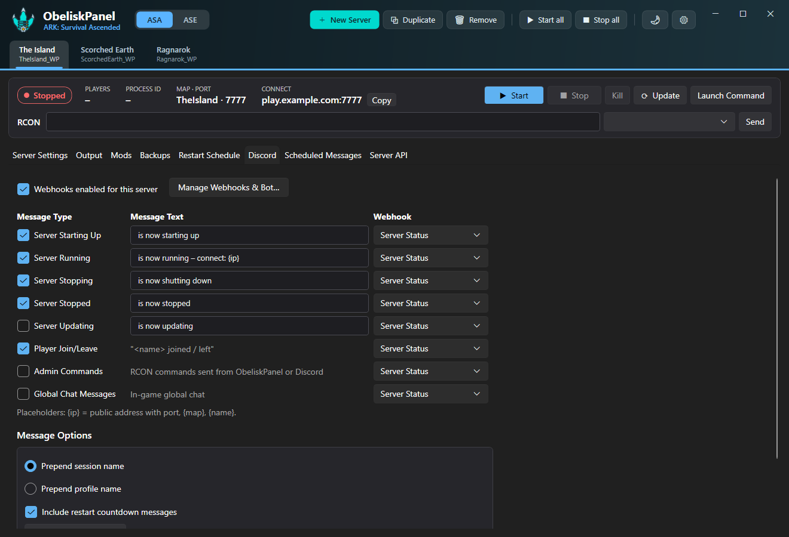

### And the small stuff

<table>
<tr>
<td width="50%">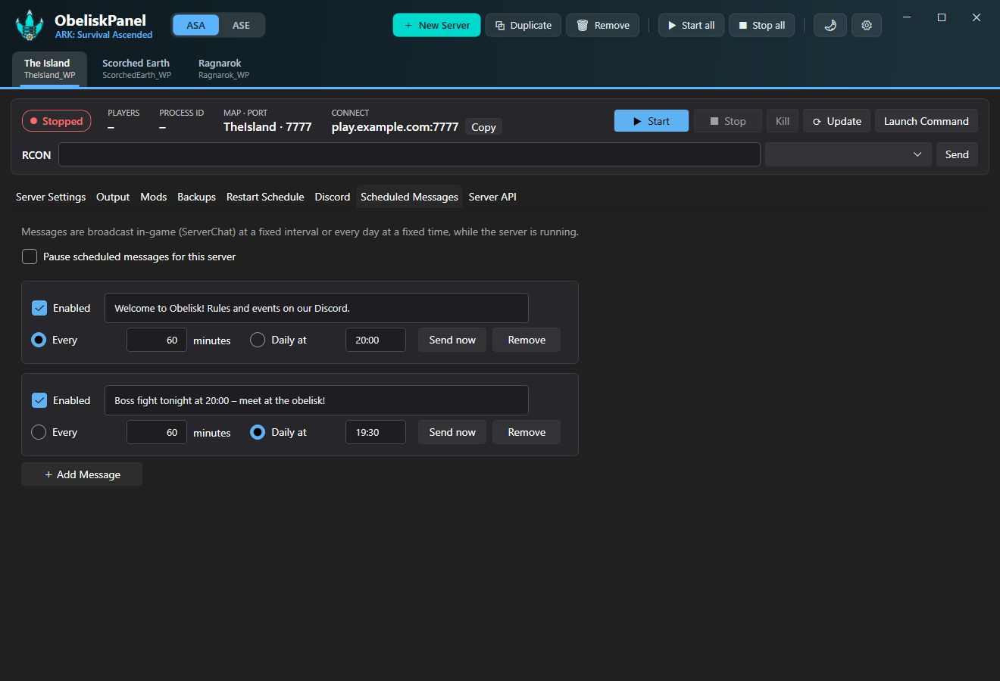<br><sub><b>Scheduled messages</b>: rules or event reminders in chat, every X minutes or daily.</sub></td>
<td width="50%">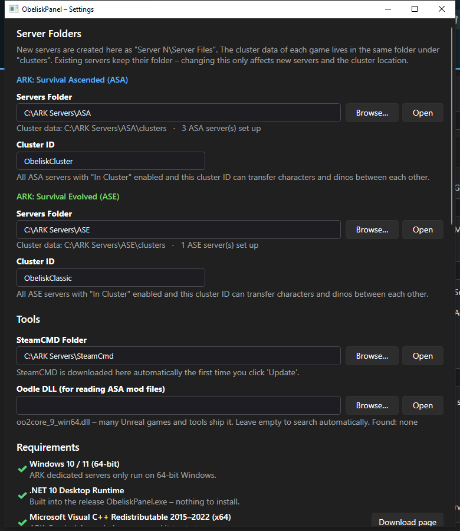<br><sub><b>Settings</b>: server folders, cluster IDs, SteamCMD, Discord, API keys.</sub></td>
</tr>
<tr>
<td width="50%">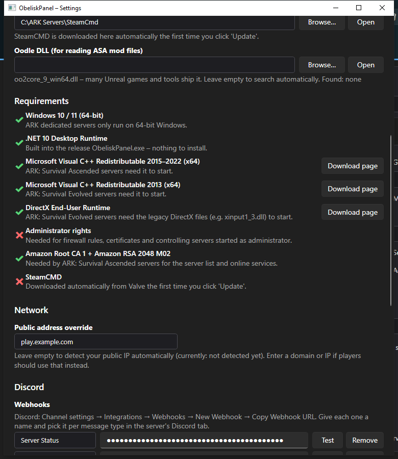<br><sub><b>Requirements check</b>: shows what's missing and takes you to the official download.</sub></td>
<td width="50%">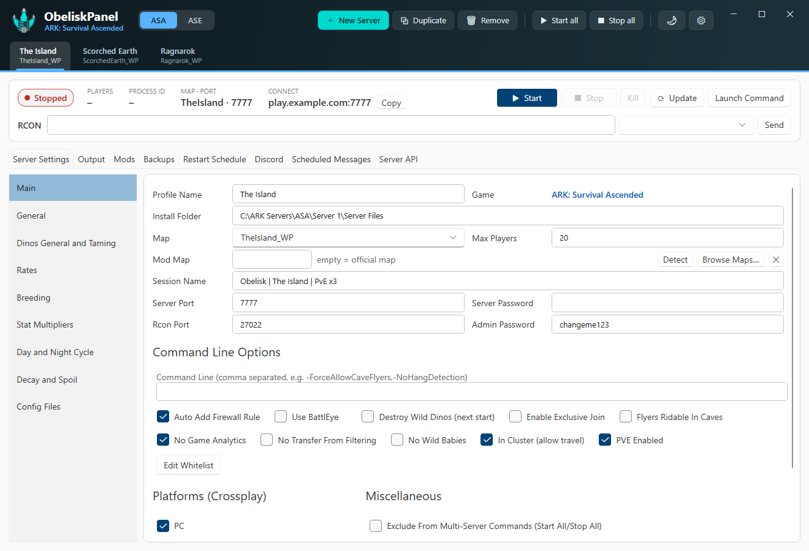<br><sub><b>Light and dark theme</b>, or follow Windows.</sub></td>
</tr>
</table>

Also included:

- RCON console with common commands
- Automatic firewall rules
- AsaApi / ArkServerApi installer
- Cluster setup per game
- Whitelist and admin list editor
- A check for the Amazon certificates that ASA servers need

---

## Getting started

1. Download **[ObeliskPanel-1.0.0-win-x64.zip](../../raw/main/release/ObeliskPanel-1.0.0-win-x64.zip)**. The download starts right away.
2. Unzip it wherever you like and start `ObeliskPanel.exe`. Keep the other files next to it, they're the libraries it needs.
3. Allow administrator rights when Windows asks. The app works without them, but things like firewall rules won't.
4. Click **＋ New Server**, pick a map, then hit **Update**. That downloads the server files.
5. Hit **Start**. Done.

> [!TIP]
> Already have servers from another tool? Point the **Servers Folder** in ⚙ Settings to that folder. Your existing saves and backups show up there.

---

## Requirements

ObeliskPanel needs the **.NET 10 Desktop Runtime**. If you don't have it, Windows tells you when you start the exe and offers to open the official download page. Click **Yes**, install it, and start ObeliskPanel again.

When the app starts it checks for everything else. If something is missing, it asks whether you want to install it, and **Yes** opens the official download page in your browser. You can see the same list under ⚙ Settings → Requirements.

| What | Needed for |
|---|---|
| Windows 10 / 11, 64-bit | everything |
| [.NET 10 Desktop Runtime](https://dotnet.microsoft.com/download/dotnet/10.0) | ObeliskPanel itself |
| Visual C++ Redistributable 2015–2022 (x64) | ASA servers |
| Visual C++ Redistributable 2013 (x64) | ASE servers |
| DirectX End-User Runtime | ASE servers |
| Amazon Root CA 1 + Amazon RSA 2048 M02 | ASA server list and online services (ObeliskPanel can install them for you) |
| Administrator rights | firewall rules, certificates, controlling servers that run as admin |
| SteamCMD | downloaded automatically from Valve |

---

## API keys

All of these are optional and free. They are stored only on your PC, in `%APPDATA%\ObeliskPanel\settings.json`.

| Key | What for | Where to get it |
|---|---|---|
| CurseForge | ASA mod browser and mod names | [console.curseforge.com](https://console.curseforge.com) |
| Steam Web API | ASE Workshop search (adding by ID or link works without it) | [steamcommunity.com/dev/apikey](https://steamcommunity.com/dev/apikey) |
| Discord bot token | the Discord bot | [discord.com/developers/applications](https://discord.com/developers/applications) |

---

## Building from source

You need the [.NET 10 SDK](https://dotnet.microsoft.com/download/dotnet/10.0) on Windows.

```powershell
git clone https://github.com/<your-name>/ObeliskPanel.git
cd ObeliskPanel
dotnet build ObeliskPanel.csproj -c Release
```

The exe ends up in `bin\Release\net10.0-windows\`.

To build the release zip yourself:

```powershell
.\build-release.ps1 -Version 1.0.0
```

That creates `release\ObeliskPanel-1.0.0-win-x64.zip`. Inside, `ObeliskPanel.exe` sits at the top next to its libraries and a short `README.txt`.

---

## Why I built this

I run my own ARK servers, and I wanted a proper tool for it. The managers out there either lock basic stuff like clusters, backups, restart schedules or Discord messages behind a paid tier, or they cost more than the game itself. For a tool that mostly starts a server and edits a couple of INI files, I find those prices honestly outrageous.

So I built my own and I'm giving it away. Everything is in here, and there's nothing to unlock. If it saves you some money or some headaches, that's all I wanted.
